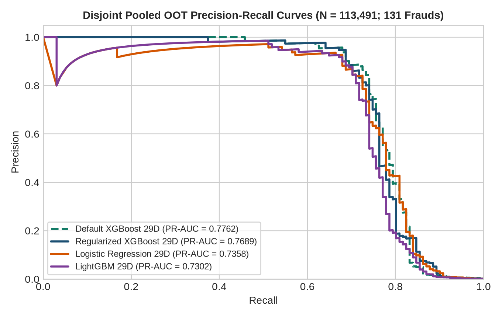
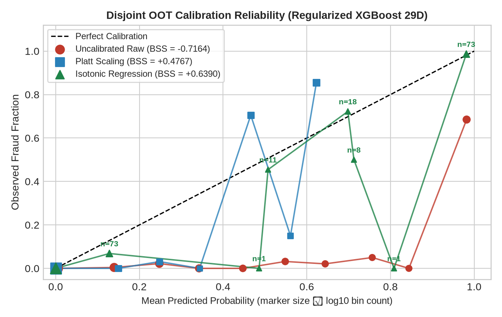
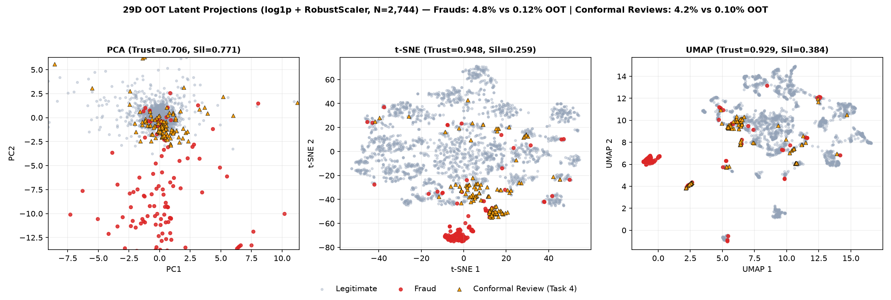

# RiskPulse Platform — Validated Temporal Baseline for Imbalanced Fraud Detection

A temporally validated, fixed-capacity fraud detection baseline on the ULB Credit Card Fraud dataset. Rather than optimizing on leaked stratified splits, this study evaluates model families, probability calibration, dollar-weighted objectives, and rolling-quantile alert policies under strict disjoint Out-Of-Time (OOT) windows.

> **Core Finding:** Regularized 29D XGBoost reaches **~0.77 pooled OOT PR-AUC** (`0.7689` at seed 42; `0.7742 ± 0.0041` across 5 seeds) and **~78% recall** at a `0.20%` review budget. Extra features, aggressive hyperparameter tuning, amount weighting, and ensembling add no detectable gain under hourly block-bootstrapped CIs, while sustained fraud bursts remain the primary operational weakness.

---

## Disjoint OOT Benchmark Summary

Evaluated across 3 disjoint chronological OOT windows (`[60%, 73%]`, `[73%, 86%]`, `[86%, 100%]`; pooled `N = 113,491` transactions, `131` frauds) using a `6,000`-transaction hourly block bootstrap (`1,000` replicates, seed `42`).

| Model (29D: `Amount` + `V1–V28`) | Pooled OOT PR-AUC | Recall @ 0.20% Budget | Precision @ 0.20% | Dollar Recall @ 0.20% |
| :--- | :---: | :---: | :---: | :---: |
| **Default XGBoost 29D** | `0.7762` | ~78% | ~45% | `64.4%` |
| **Regularized XGBoost 29D (Primary)** | `0.7689` *(5-seed: `0.7742 ± 0.0041`)* | `78.6%` | `45.6%` | `64.4%` |
| **Logistic Regression 29D** | `0.7358` | — | — | — |
| **LightGBM 29D** | `0.7302` | — | — | — |
| **Log-Amount-Weighted XGB 29D (`1–3×`)** | `0.7613` `[0.6785, 0.8268]` | `77.1%` | `44.7%` | `64.4%` |
| **Linear-Amount-Weighted XGB 29D (cap `$1k`)** | `0.7791` `[0.7045, 0.8370]` | `80.2%` | `46.5%` | `65.6%` |

* **Dollar-Recall Ceiling:** Even strong linear dollar-proportional weighting produces no detectable change (`ΔPR-AUC = -0.0094 [-0.0266, +0.0102]`; `+1.2` pp dollar recall, ~1 transaction), indicating the `64.4%–65.6%` ceiling is driven by feature-space separability rather than an unweighted loss artifact.

---

## Probability Calibration

Class weighting (`scale_pos_weight`) makes raw XGBoost probabilities severely overconfident (`BSS = -0.7164`, `ECE = 0.00656`). Fitting monotonic **Isotonic Regression** on the preceding calibration window raises Brier Skill Score to **`+0.6390`** (`ECE = 0.00011`, vs. Platt scaling `BSS = +0.4767`). Because overall ECE is dominated by ~113,300 near-zero-score transactions, high-score calibration is evidenced by BSS and the top probability bin (`n = 73`, `98.6%` observed fraud rate).

---

## Streaming Alert Policy & Burst Resilience (`0.20%` Budget)

Online threshold adaptation using a `W = 20,000` label-free rolling-score quantile paired with an isotonic high-confidence guard (`P_cal >= 0.80`):

| Stream Scenario | Policy | Alerts (Rate) | Recall (TP / Total) | Precision |
| :--- | :--- | :---: | :---: | :---: |
| **Normal OOT Stream** (`131` frauds) | `quarantine_guard_only` | `269` (`0.237%`) | `79.4%` (`104 / 131`) | `38.7%` |
| **Burst 1** (`+500` jittered @ 20k; `631` total) | `quarantine_guard_only` | `485` (`0.425%`) | `55.2%` (`348 / 631`) | `71.8%` |
| **Burst 2** (`+1,000` jittered @ 65k; `1,131` total) | `standard` | `501` (`0.438%`) | `34.9%` (`395 / 1,131`) | `78.8%` |
| **Burst 2** (`+1,000` jittered @ 65k; `1,131` total) | `quarantine_guard_only` | `634` (`0.554%`) | `44.0%` (`498 / 1,131`) | `78.5%` |

* `quarantine_guard_only` prevents high-confidence (`P_cal >= 0.80`) burst alerts from polluting the rolling buffer—recovering `+103` additional frauds in Burst 2—while avoiding the `7×` alert explosion of `quarantine_all`.
* **Operational Limit:** No tested variant maintains the `0.20%` fixed analyst capacity under a sustained burst (Burst 2 reaches `~2.8×` budget and still misses `56%` of frauds); a hard per-window alert cap is the next operational control.

---

## Repository Structure & Reproducibility

* `src/ml/predictor.py` — Production inference wrapper with `quarantine_guard_only` rolling buffer logic.
* `src/ml/final_disjoint_reconciliation.py` — Disjoint rolling OOT evaluation & hourly block-bootstrap CIs.
* `src/ml/final_two_checks.py` — Linear vs. log dollar-weighting ablation and independent 1,000-fraud burst check.
* `src/ml/complete_table1_and_plots.py` & `src/ml/update_final_figures.py` — Complete Table 1 metrics and diagnostic plots.
* `figures/` — Final PR-curve (`fig_pr_curves.png`) and bin-count annotated reliability (`fig_reliability.png`) plots.
* `artifacts/` — Exported `.joblib` model bundles and audit outputs.

**Environment (reproducible with fixed seeds):** `Python 3.14.8` · `xgboost 3.4.1` · `scikit-learn 1.9.1` · `lightgbm 4.7.0`

---

## v2 Research Extensions (ULB Policy + IEEE-CIS Cross-Dataset Replication)

Evaluated in release `v2.1.0` (`4d7ec75`, merged to `main`) using the same strict disjoint OOT protocol (`[60%, 73%]`, `[73%, 86%]`, `[86%, 100%]`), post-hoc Isotonic calibration, and block-bootstrapped 95% CIs:

* **IEEE-CIS Disjoint OOT Baseline (`N=590,537`, `20,663` frauds):** Pooled OOT PR-AUC **`0.4835`** (`[0.4576, 0.5087]`); Isotonic calibration repairs raw Brier Skill Score from **`-1.0234` → `+0.2991`**.
* **Strictly Causal Entity & Velocity Features:** Both `card1+addr1` (1h/24h rolling windows, `0.4833`, `ΔPR-AUC = -0.0002`, 95% CI `[-0.0043, +0.0046]`) and `card1+addr1+D1` (`0.4818`) match the static baseline due to IEEE-CIS's pre-engineered `C1–C14` and `D1–D15` features.
* **Expected-Loss Queue Ranking (`P_cal × (Amount + $25)`):** Flat on ULB (`64.4% → 64.4%`, 95% CI `[-2.7%, +6.5%]`), but lifts IEEE-CIS dollar recall by **`+20.4 pp`** at 2% budget (`27.2% → 47.6%`) and **`+16.2 pp`** at 5% budget (`49.9% → 66.1%`).
* **Novel Attack Blind-Spot Test (IEEE-CIS, `ProductCD='C'`):** Holding out 4,412 `ProductCD='C'` frauds drops OOT recall under the global 5% budget to 0.0% (0/3,596). Under an equal-volume channel budget (`k_C = 1,371`, 38.1% recall ceiling), recall progresses from **34.4%** (supervised control) → **14.8%** (held-out supervised, 38.9% precision) → **23.0%** (unsupervised Isolation Forest, 60.2% precision).
* **Two-Tier Streaming Policy (`src/ml/predictor.py`):** Auto-declines (`P_cal >= 0.80`) bypass the human review cap (`88.5%` precision on IEEE-CIS), while the hard-capped human queue stays strictly under budget (`1.92%` vs. `2.0%` cap), delivering **`40.0%` combined recall** and **`53.9%` overall precision**.

---

## Machine Learning & Statistical Validation (Tasks 2, 3, 4, 7 — `v2.2.0`)

Full `v2.1` core methodology and cross-dataset audit are documented in [`riskpulse_technical_report_v2.pdf`](riskpulse_technical_report_v2.pdf) (`v2.1.0`, commit `4d7ec75`). All Tasks 2, 3, 4, and 7 artifacts below are fully reproducible from `src/ml/v2_2_*.py` on the deduplicated 29D chronological OOT ULB dataset (release `v2.2.0`).

### 1. Model Benchmarking & Statistical Validation (Tasks 2 & 3 — `src/ml/v2_2_benchmark_and_stats.py`)
* **5-Model Expanding Temporal Benchmark (`artifacts/benchmark_results.csv`):** Evaluated Logistic Regression, Random Forest, XGBoost, SVM (RBF), and MLP across **10 expanding chronological OOT windows** (`[50%, 100%]`, fixed 0.20% alert budget) on Precision, Recall, F1, ROC-AUC, PR-AUC (with 95% bootstrap CIs), MCC, Brier Score, and inference latency (`ms/txn`).
  * Mean OOT PR-AUC: Random Forest `0.7830` (`[0.7016, 0.8495]`), Logistic Regression `0.7722` (`[0.6765, 0.8412]`), XGBoost `0.7681` (`[0.6839, 0.8391]`, fastest at `0.00027 ms/txn`), MLP `0.7623` (`[0.6851, 0.8287]`), SVM (RBF) `0.2932` (`[0.2185, 0.3738]`, trained on all window frauds + 15k legitimate subsample for $O(N^2)$ tractability).
* **Friedman Omnibus Test (`artifacts/statistical_summary.json`):** Across all 5 models ($\text{df} = 4$, 10 expanding OOT windows), $\chi^2 = 21.04$, $p = 0.0003109$ (significant at $\alpha = 0.05$).
* **Post-Hoc Tests (`artifacts/statistical_tests.csv`):** Pairwise Wilcoxon signed-rank tests with Holm-Bonferroni correction and Cliff's $\delta$ show XGBoost significantly outperforms SVM (RBF) ($p_{\text{adj}} = 0.0078$, $\delta = 0.96$), while differences vs. RF, LR, and MLP are non-significant ($p_{\text{adj}} \ge 0.826$).

### 2. Uncertainty Quantification & Blind-Spot Routing (Task 4 — `src/ml/v2_2_conformal_and_ensemble.py`)
* **Mondrian Split-Conformal Prediction (`artifacts/conformal.json`):** Class-conditional nonconformity score $1 - p_{\text{cal}}(\text{true class})$ across 3 disjoint OOT windows ($N = 113,491$, 131 frauds) achieves **99.47%** legitimate coverage (target 99.5%) and **81.68%** fraud coverage (target 85.0%), routing **0.899%** (`1,020` cases) to human review.
* **5-Seed Ensemble Disagreement (`seeds = {7, 21, 42, 84, 128}`):** Mean epistemic standard deviation is **25× higher** on review cases (`0.00539`) and **137× higher** on frauds (`0.02884`) than on legitimate transactions (`0.00021`).
* **Held-Out Channel (`ProductCD='C'`, equal-volume `k_C = 1,371`, 38.1% ceiling):** Recall progresses from 34.4% (control) → 14.8% (held-out supervised, 0.0% under global budget) → 23.0% (unsupervised Isolation Forest, 60.2% precision).

### 3. Latent Space Projections (Task 7 — `src/ml/v2_2_latent_projections.py`)
Reproducible PCA, t-SNE, and UMAP projections on a stratified OOT subsample (`artifacts/latent_projections.json`, $N = 2,725$; all 131 OOT frauds = 4.81% plotted vs. 0.12% true OOT prevalence):
* **PCA:** Trustworthiness (`k=15`) `0.6614`, Silhouette `0.8080` (33.45% variance explained).
* **t-SNE:** Trustworthiness (`k=15`) `0.9504`, Silhouette `0.2367`.
* **UMAP:** Trustworthiness (`k=15`) `0.9251`, Silhouette `0.4619`.

